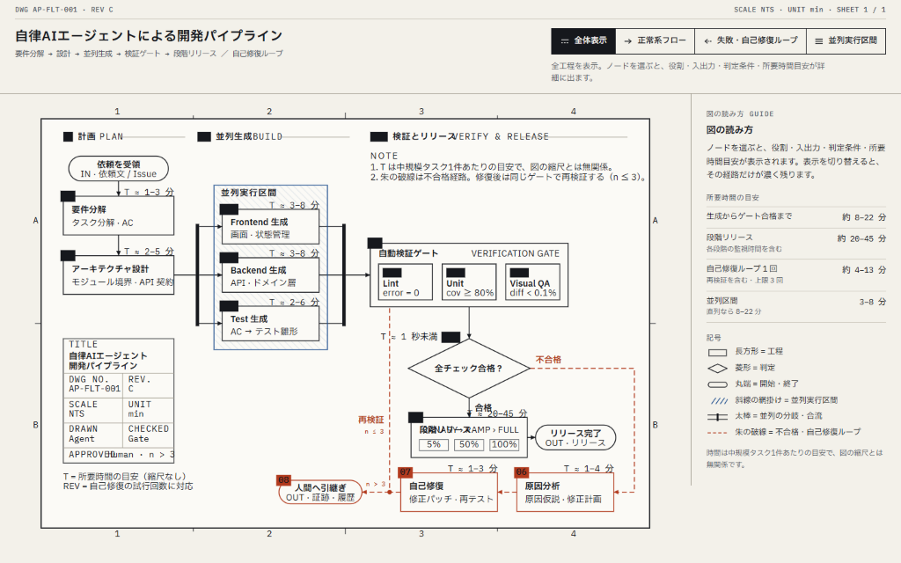
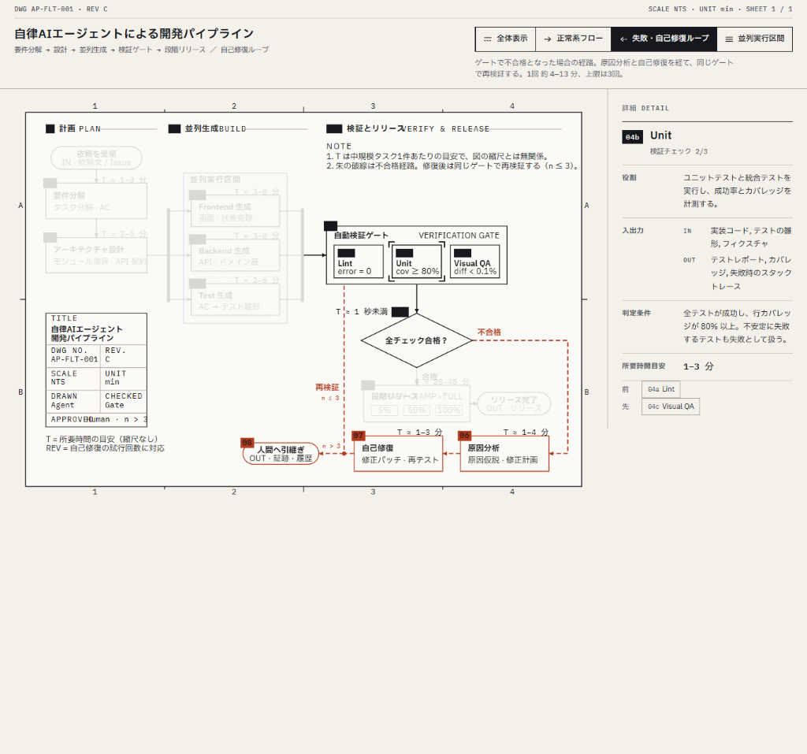
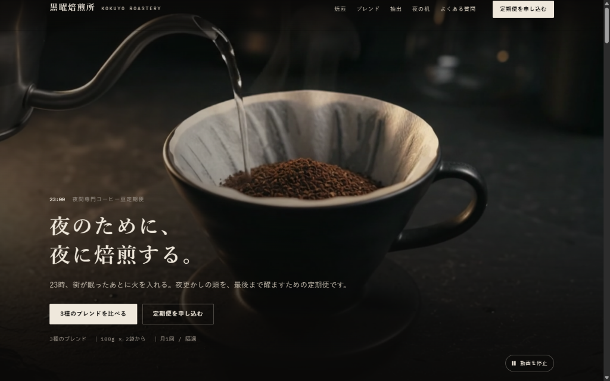
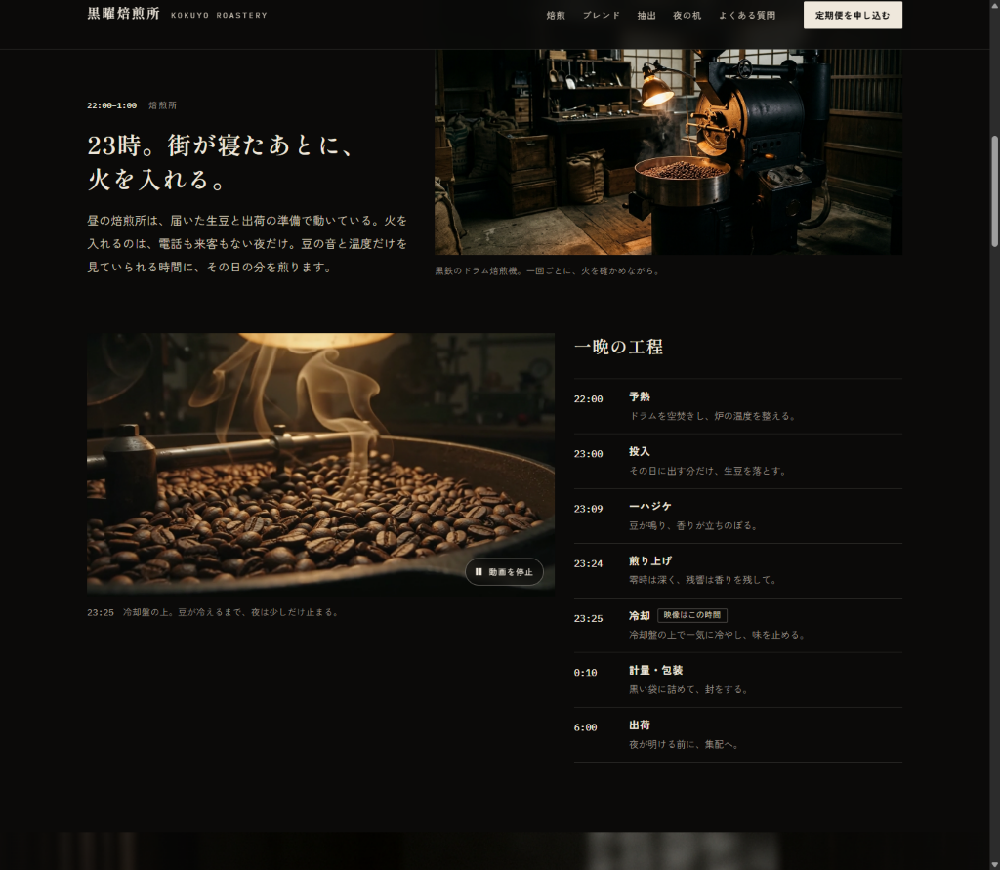
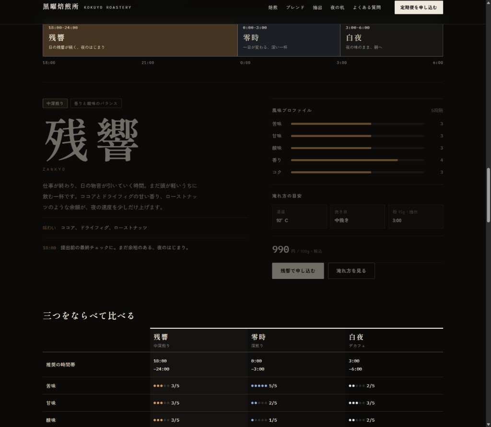
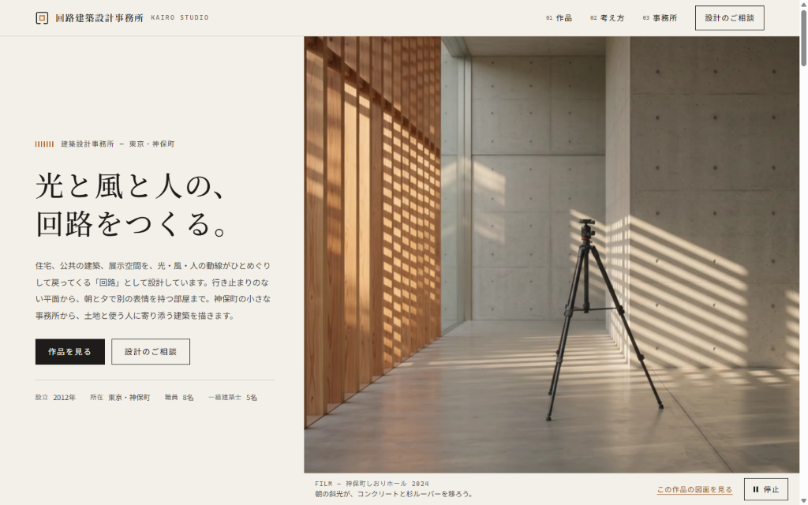
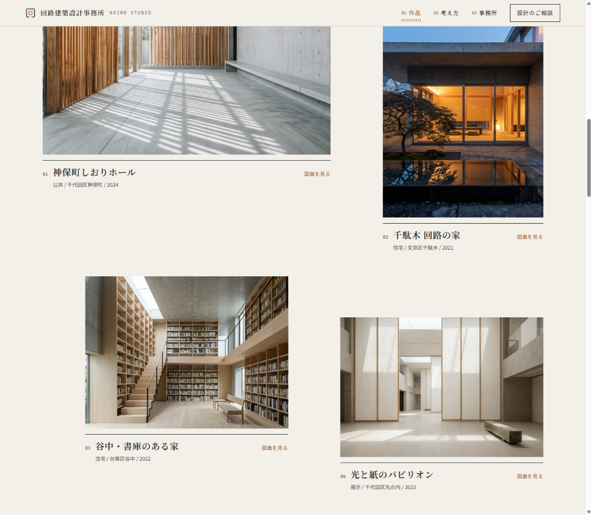
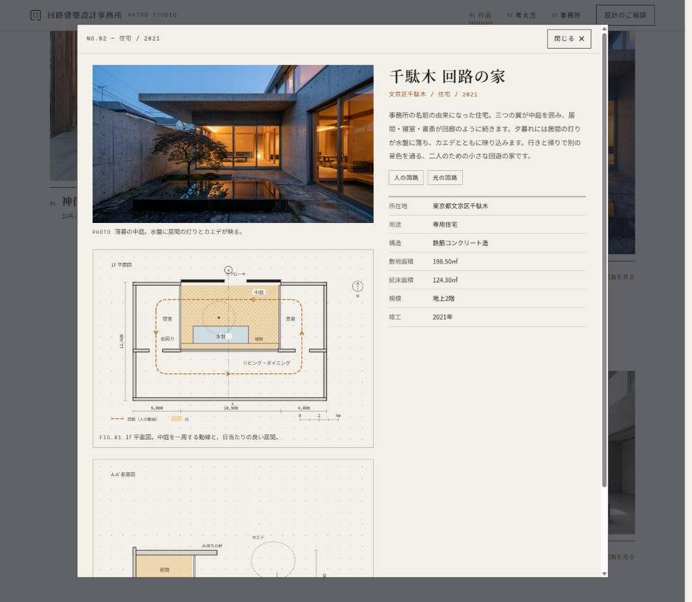
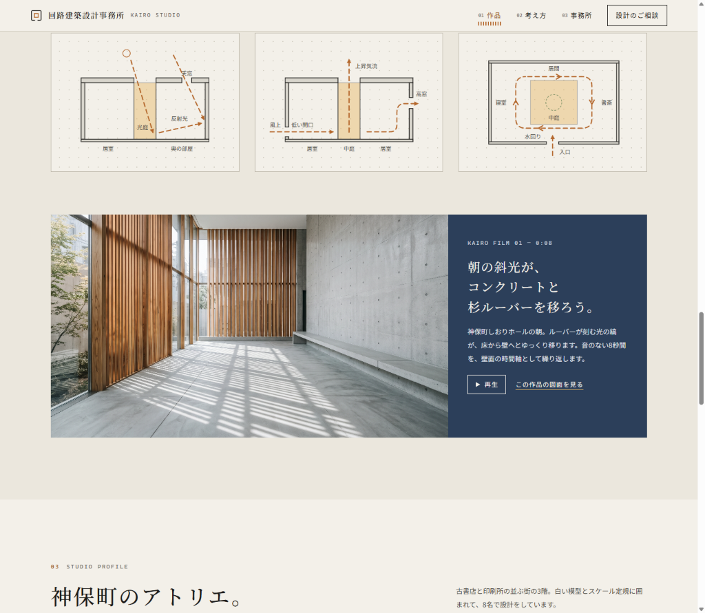
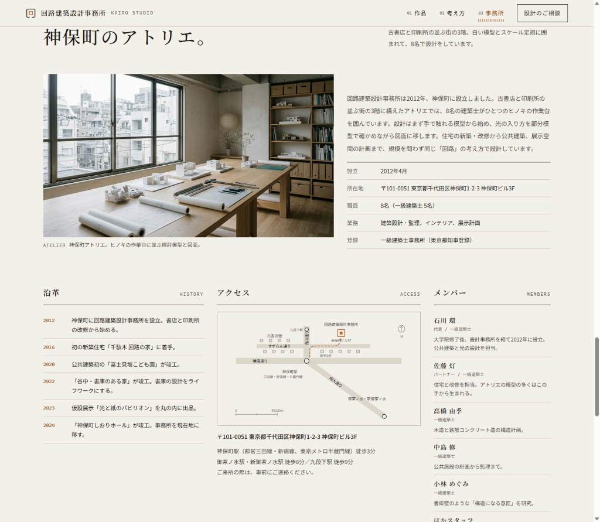

<div align="center">

# 🎨 GLM-5.4 Art Direction Lab

**T3 Code 上の GLM-5.4 × `anything-frontend-art-direction` スキル × Google Flow オリジナルアセット（全13点）によるフロントエンド並列実験アーカイブ**

[](./LICENSE)
[](https://z.ai)
[](https://github.com/RNA4219/anything-frontend-art-direction)
[-3d5a80.svg)](https://flow.google.com/)

[English](./README.md) · [日本語](./README.ja.md)

</div>

---

## ✨ 概要

本リポジトリは、**T3 Code** 上で **GLM-5.4**（`claude_glm/glm-5.4`）に [anything-frontend-art-direction](https://github.com/RNA4219/anything-frontend-art-direction) スキルを適用し、異なる3題材のフロントエンドを並列制作した実験成果物まとめです。

1. **インタラクティブ・フローチャート**（`flowchart/`） — JIS 工業製図面（`DWG AP-FLT-001`）の佇まいで構成した自律AI開発パイプライン図解
2. **ランディングページ**（`lp-pure-glm54/`） — 夜間専門スペシャルティコーヒー豆定期便「黒曜焙煎所（KOKUYO ROASTERY）」（動画2本＋静止画4枚を 100% 純 GLM-5.4 が自力実装）
3. **公式ホームページ**（`homepage-pure-glm54/`） — 東京・神保町の建築＆空間設計スタジオ「回路建築設計事務所（KAIRO STUDIO）」（建築フィルム動画1本＋建築写真6枚＋インラインSVG平面図・断面図を 100% 純 GLM-5.4 が自力実装）

使用している画像・動画（MP4動画3本＋JPEG写真10枚＝計13点）はすべて **Google Flow** でオリジナル生成して `assets/` に配置しており、**外部Webサイトの画像・動画URLは一切使用していません**。

---

## 🖼️ 成果物ギャラリー（100% 純 GLM-5.4）

### 1. インタラクティブ・フローチャート（`flowchart/index.html`）

| 初期全体表示（製図用紙＋座標グリッド） | フィルタ切替＆右側詳細パネル |
| :---: | :---: |
|  |  |

### 2. LP — 黒曜焙煎所 KOKUYO ROASTERY（`lp-pure-glm54/index.html`）

| フルブリード動画ヒーロー | 焙煎所＆「一晩の工程」タイムライン | 3種ブレンド比較 |
| :---: | :---: | :---: |
|  |  |  |

### 3. ホームページ — 回路建築設計事務所 KAIRO STUDIO（`homepage-pure-glm54/index.html`）

| 建築フィルム動画ヒーロー | Selected Works スタッガード一覧 | 詳細モーダル（写真＋SVG平面図・断面図） |
| :---: | :---: | :---: |
|  |  |  |

| 設計思想（3原則SVG＋建築フィルム） | 事務所概要（神保町アトリエ） |
| :---: | :---: |
|  |  |

---

## 📊 成果物一覧

| 作品 | ファイル | サイズ | ローカルアセット | 外部メディアURL | コンソールエラー |
| --- | --- | ---: | :---: | :---: | :---: |
| **01. フローチャート（純 GLM-5.4）** | [`flowchart/index.html`](./flowchart/index.html) | 48.5 KB | インラインSVG | 0 | 0 |
| **02. LP（100% 純 GLM-5.4）** | [`lp-pure-glm54/index.html`](./lp-pure-glm54/index.html) | 71.3 KB | 6 / 6（動画2＋静止画4） | 0 | 0 |
| **03. HP（100% 純 GLM-5.4）** | [`homepage-pure-glm54/index.html`](./homepage-pure-glm54/index.html) | 110.9 KB | 7 / 7（動画1＋静止画6） | 0 | 0 |
| *比較用 v1：縦書き LP* | [`lp/index.html`](./lp/index.html) | 54.8 KB | 6 / 6 | 0 | 0 |
| *比較用 v1：縦書きモノグラフ HP* | [`homepage/index.html`](./homepage/index.html) | 87.9 KB | 7 / 7 | 0 | 0 |

---

## 🚀 ローカルプレビュー方法

Node.js 18 以上があれば外部パッケージ不要でそのまま起動できます（動画再生の Range リクエスト対応）：

```bash
node preview-server.mjs
```

起動後、ブラウザで以下にアクセスしてください：
- ギャラリーポータル: `http://127.0.0.1:3788/`
- フローチャート: `http://127.0.0.1:3788/flowchart/`
- 純 GLM-5.4 LP: `http://127.0.0.1:3788/lp-pure-glm54/`
- 純 GLM-5.4 HP: `http://127.0.0.1:3788/homepage-pure-glm54/`

---

## ⚙️ 実験ノウハウ：T3 Code × GLM-5.4 でのリトライ上限引き上げ

Z.ai の Anthropic 互換エンドポイント（`https://api.z.ai/api/anthropic`）で複数スレッドを並列実行すると、Claude Code の既定リトライ上限（10回）で `429 rate_limit` 終了する場合があります。`~/.t3/userdata/settings.json` の `claude_glm` プロバイダーに以下を追加することで、71KB〜110KB の長文ビルドも最後まで自力完走できました。

```json
{
  "name": "CLAUDE_CODE_MAX_RETRIES",
  "value": "100",
  "sensitive": false
},
{
  "name": "API_TIMEOUT_MS",
  "value": "3000000",
  "sensitive": false
}
```

---

## 📁 ディレクトリ構成

```text
.
├── index.html                   # ギャラリーポータル（GitHub Pages エントリ）
├── preview-server.mjs           # ゼロ依存ローカルプレビューサーバー（動画Range対応）
├── flowchart/
│   └── index.html               # 01. 自律AI開発パイプライン（純 GLM-5.4）
├── lp-pure-glm54/
│   └── index.html               # 02. 黒曜焙煎所 LP（100% 純 GLM-5.4）
├── homepage-pure-glm54/
│   └── index.html               # 03. 回路建築設計事務所 HP（100% 純 GLM-5.4）
├── lp/
│   └── index.html               # 比較用 v1（縦書き LP）
├── homepage/
│   └── index.html               # 比較用 v1（縦書きモノグラフ HP）
├── assets/                      # Google Flow 生成オリジナルアセット（全13点）
├── docs/screenshots/            # 実機検証スクリーンショット（1440×900）
├── .github/workflows/pages.yml  # GitHub Pages 自動デプロイ設定
├── README.md
├── README.ja.md
└── LICENSE
```

---

## 🙏 クレジット・ライセンス

- アートディレクションスキル: [RNA4219/anything-frontend-art-direction](https://github.com/RNA4219/anything-frontend-art-direction)（MIT）
- オリジナル画像・動画: [Google Flow](https://flow.google.com/) でローカル生成
- コード・ドキュメント: [MIT License](./LICENSE)
