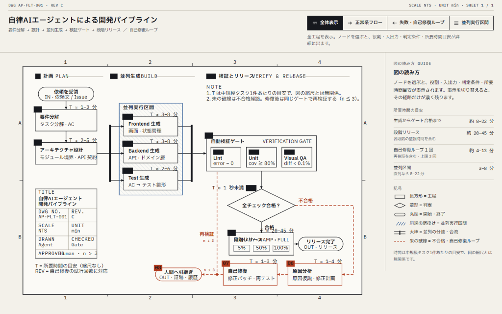
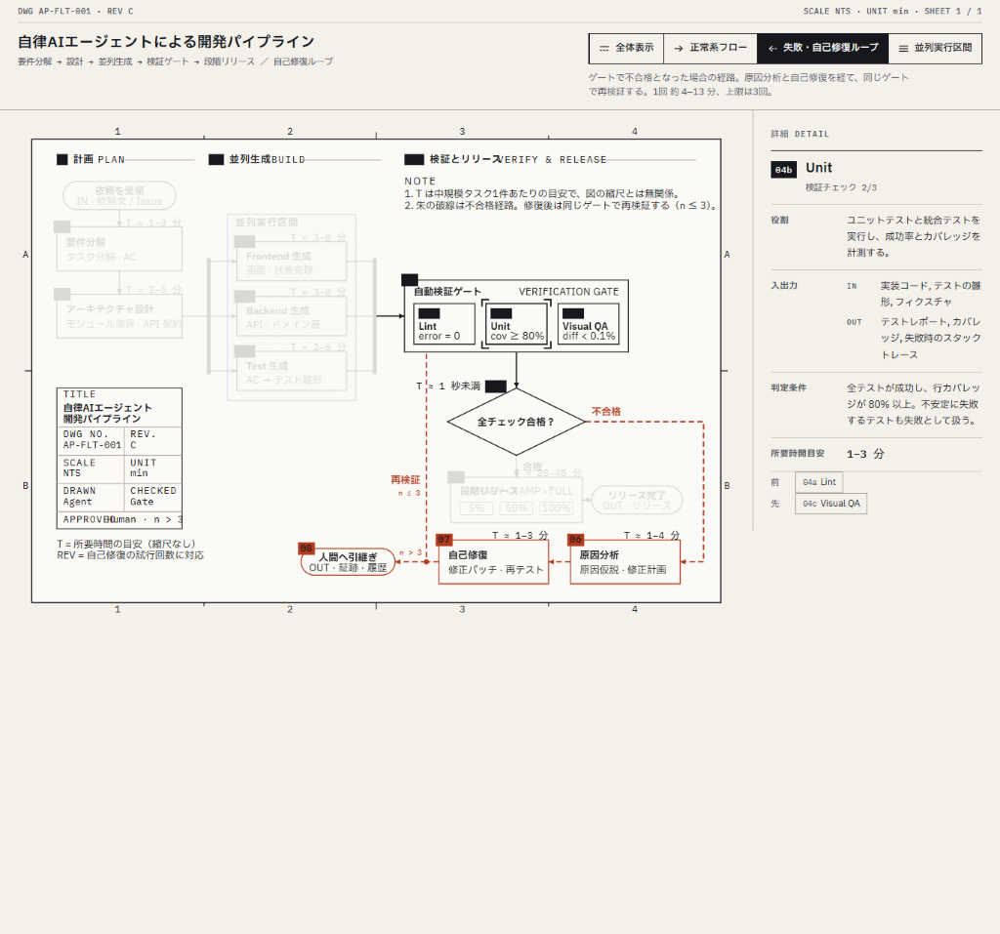
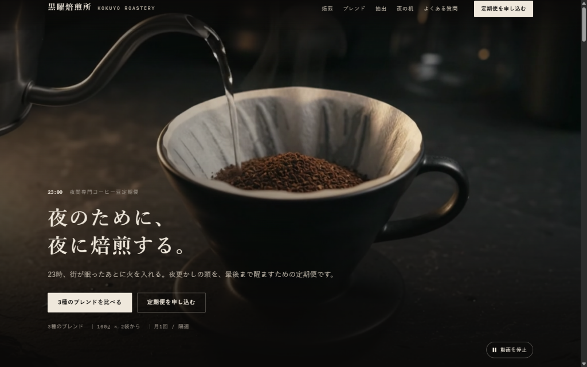
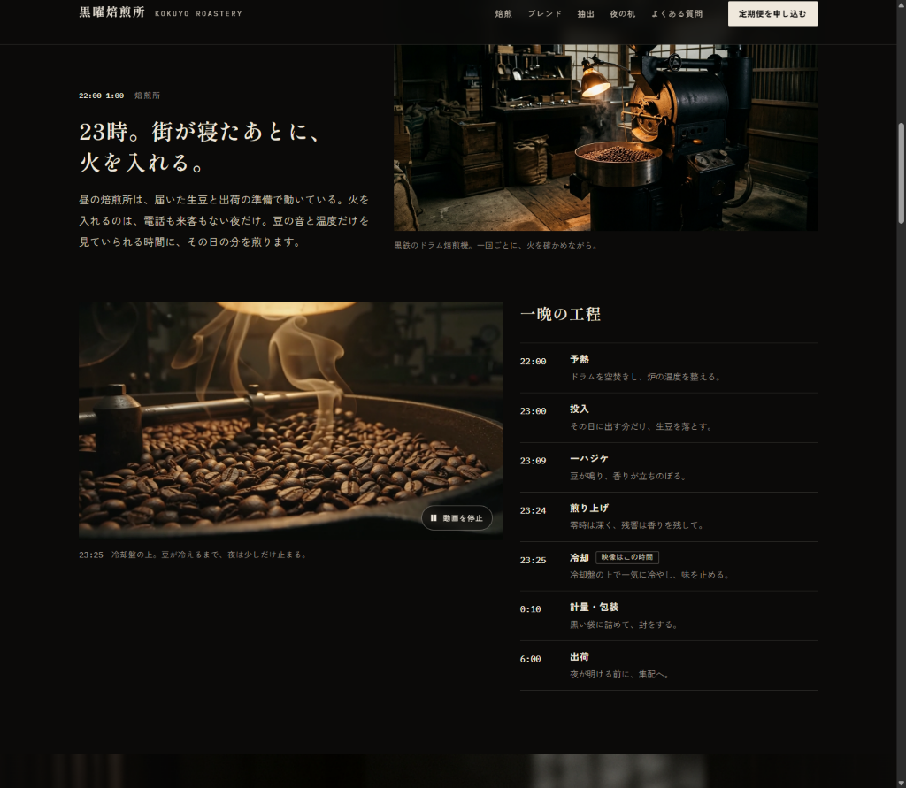
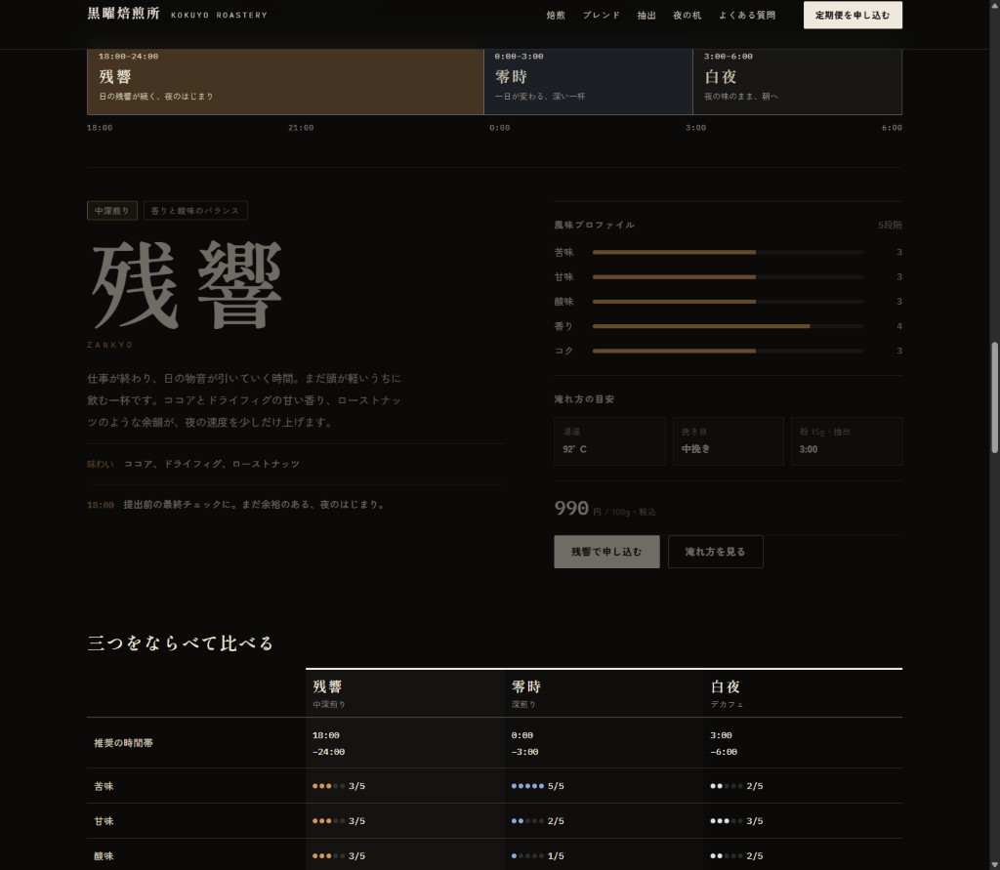
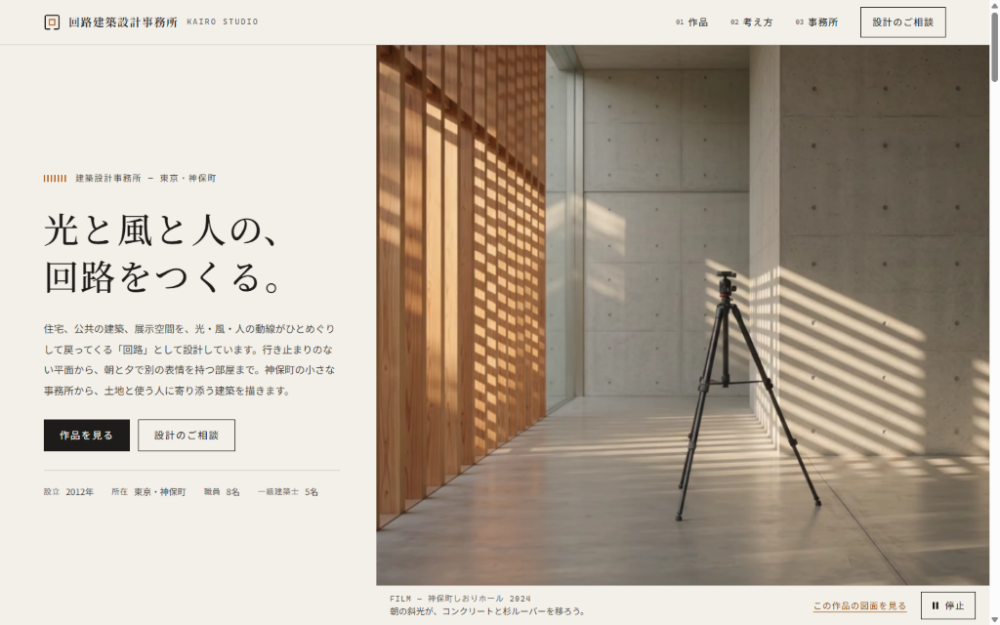
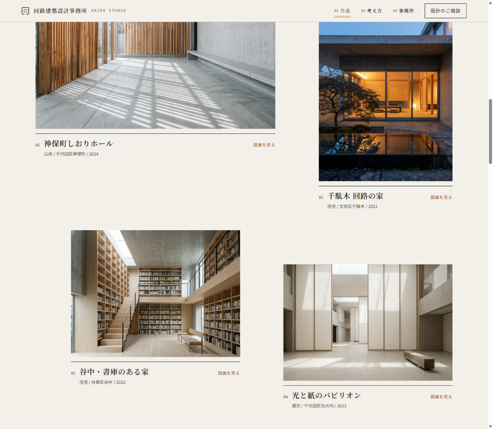
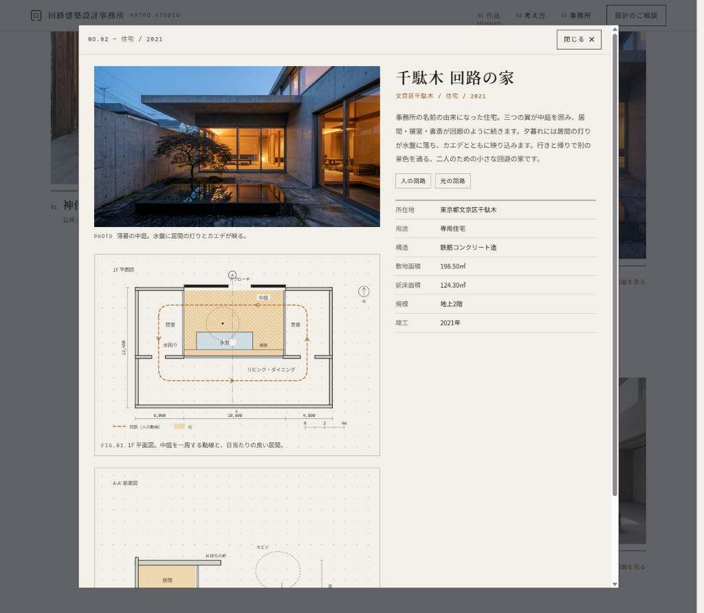
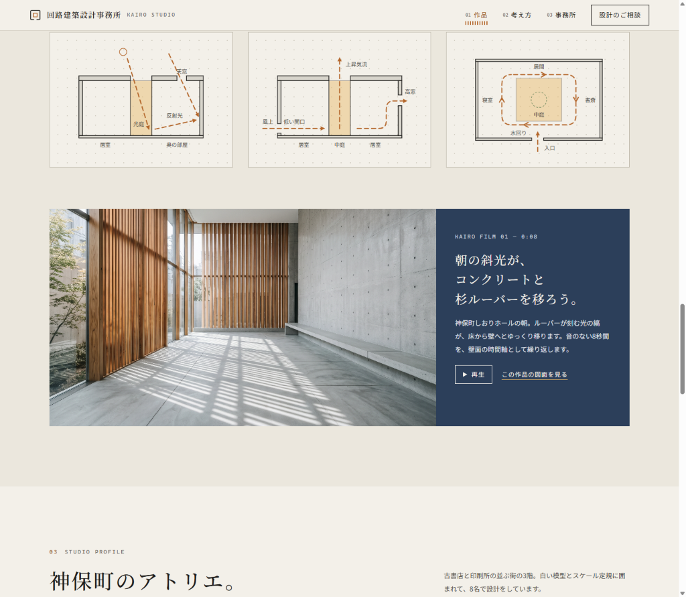
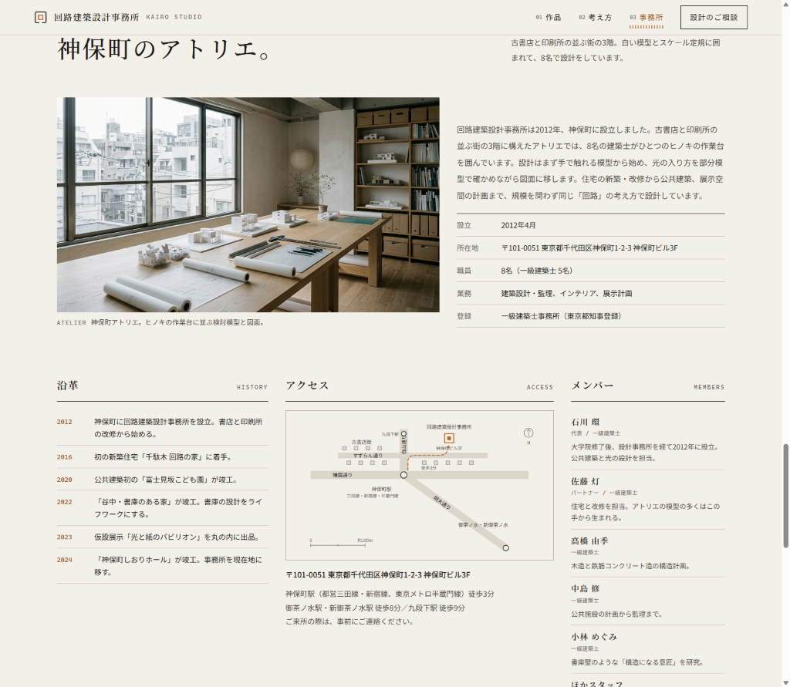

<div align="center">

# 🎨 GLM-5.4 Art Direction Lab

**Parallel frontend art-direction experiments with GLM-5.4 in T3 Code, guided by `anything-frontend-art-direction` and powered by 13 original Google Flow assets.**

[](./LICENSE)
[](https://z.ai)
[](https://github.com/RNA4219/anything-frontend-art-direction)
[-3d5a80.svg)](https://flow.google.com/)

[English](./README.md) · [日本語](./README.ja.md)

</div>

---

## ✨ Overview

This repository collects three parallel frontend experiments executed on **T3 Code** using **GLM-5.4** (`claude_glm/glm-5.4`) with the [anything-frontend-art-direction](https://github.com/RNA4219/anything-frontend-art-direction) skill:

1. **Interactive Flowchart** (`flowchart/`) — Autonomous AI development pipeline styled as a Japanese engineering blueprint (`DWG AP-FLT-001`).
2. **Landing Page** (`lp-pure-glm54/`) — Fictional nocturnal specialty coffee subscription *KOKUYO ROASTERY* (*黒曜焙煎所*), 100% self-completed by GLM-5.4 using 2 original videos + 4 original images.
3. **Studio Homepage** (`homepage-pure-glm54/`) — Fictional Tokyo architectural practice *KAIRO STUDIO* (*回路建築設計事務所*), 100% self-completed by GLM-5.4 using 1 original architectural film + 6 original architectural photographs + inline SVG plans & sections.

All visual media (3 MP4 videos + 10 JPEG photographs) were generated via **Google Flow** and stored locally under `assets/`. **Zero external web image/video URLs are used.**

---

## 🖼️ Showcase Gallery (100% Pure GLM-5.4)

### 1. Interactive Flowchart — Autonomous AI Pipeline (`flowchart/index.html`)

| Initial Blueprint View | Interactive Filter & Detail Panel |
| :---: | :---: |
|  |  |

### 2. Landing Page — KOKUYO ROASTERY (`lp-pure-glm54/index.html`)

| Full-Bleed Video Hero | Roasting Room & Night Timeline | Blend Comparison |
| :---: | :---: | :---: |
|  |  |  |

### 3. Homepage — KAIRO STUDIO (`homepage-pure-glm54/index.html`)

| Architectural Film Hero | Selected Works Staggered Grid | Detail Modal (Photo + SVG Plan/Section) |
| :---: | :---: | :---: |
|  |  |  |

| Philosophy Diagrams + Film | Studio Profile (Jinbocho Atelier) |
| :---: | :---: |
|  |  |

---

## 📊 Build Summary

| Work | Path | Size | Local Assets | External Media URLs | Console Errors |
| --- | --- | ---: | :---: | :---: | :---: |
| **01. Flowchart (Pure GLM-5.4)** | [`flowchart/index.html`](./flowchart/index.html) | 48.5 KB | Inline SVG | 0 | 0 |
| **02. LP (Pure GLM-5.4)** | [`lp-pure-glm54/index.html`](./lp-pure-glm54/index.html) | 71.3 KB | 6 / 6 (2 MP4 + 4 JPG) | 0 | 0 |
| **03. Homepage (Pure GLM-5.4)** | [`homepage-pure-glm54/index.html`](./homepage-pure-glm54/index.html) | 110.9 KB | 7 / 7 (1 MP4 + 6 JPG) | 0 | 0 |
| *Variant v1: Vertical LP* | [`lp/index.html`](./lp/index.html) | 54.8 KB | 6 / 6 | 0 | 0 |
| *Variant v1: Vertical Monograph HP* | [`homepage/index.html`](./homepage/index.html) | 87.9 KB | 7 / 7 | 0 | 0 |

---

## 🚀 Quick Start (Local Preview)

Requires Node.js 18+ (zero external npm dependencies; supports HTTP Range requests for `<video>` playback):

```bash
node preview-server.mjs
```

Then open:
- Gallery Portal: `http://127.0.0.1:3788/`
- Flowchart: `http://127.0.0.1:3788/flowchart/`
- Pure GLM-5.4 LP: `http://127.0.0.1:3788/lp-pure-glm54/`
- Pure GLM-5.4 Homepage: `http://127.0.0.1:3788/homepage-pure-glm54/`

---

## ⚙️ Key Setup Note: T3 Code × GLM-5.4 Retry Limit

Running multiple parallel GLM-5.4 threads on Z.ai's Anthropic-compatible endpoint (`https://api.z.ai/api/anthropic`) can hit HTTP `429 rate_limit` under Claude Code's default `10` retries. Adding the following environment variables to your `claude_glm` provider instance in `~/.t3/userdata/settings.json` allowed both long-form builds (71 KB & 110 KB) to self-complete cleanly:

```json
{
  "name": "CLAUDE_CODE_MAX_RETRIES",
  "value": "100",
  "sensitive": false
},
{
  "name": "API_TIMEOUT_MS",
  "value": "3000000",
  "sensitive": false
}
```

---

## 📁 Repository Structure

```text
.
├── index.html                   # Static gallery portal (GitHub Pages entry)
├── preview-server.mjs           # Zero-dependency local HTTP + Range video server
├── flowchart/
│   └── index.html               # 01. Engineering blueprint flowchart (Pure GLM-5.4)
├── lp-pure-glm54/
│   └── index.html               # 02. KOKUYO ROASTERY LP (100% Pure GLM-5.4)
├── homepage-pure-glm54/
│   └── index.html               # 03. KAIRO STUDIO Homepage (100% Pure GLM-5.4)
├── lp/
│   └── index.html               # Earlier vertical-title variant (for comparison)
├── homepage/
│   └── index.html               # Earlier vertical-monograph variant (for comparison)
├── assets/                      # 13 original Google Flow assets (3 MP4 + 10 JPG)
├── docs/screenshots/            # Verified 1440x900 desktop screenshots
├── .github/workflows/pages.yml  # GitHub Pages deployment workflow
├── README.md
├── README.ja.md
└── LICENSE
```

---

## 🙏 Credits & License

- Art Direction Skill: [RNA4219/anything-frontend-art-direction](https://github.com/RNA4219/anything-frontend-art-direction) (MIT)
- Original Images & Videos: Generated locally via [Google Flow](https://flow.google.com/)
- Code & Documentation: [MIT License](./LICENSE)
